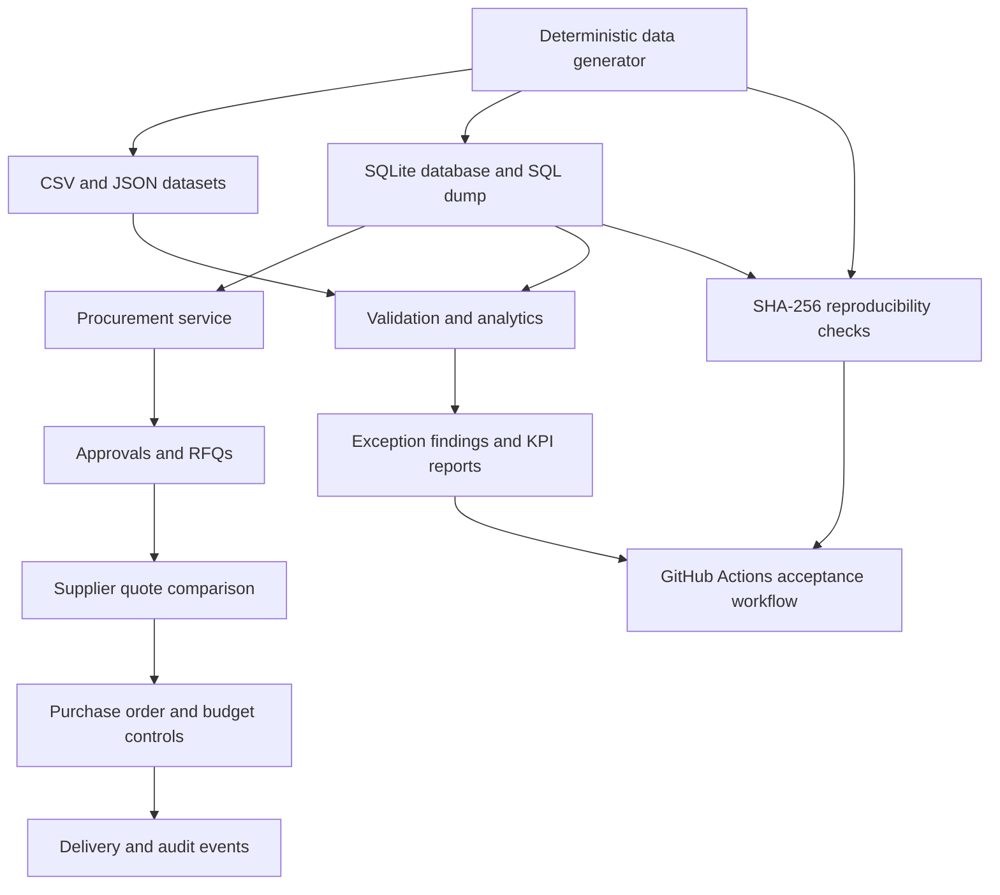

# Procurement Management System


An end-to-end **synthetic procurement workflow, control, and analytics project** built with Python and SQLite. It models the procurement lifecycle from purchase request creation through approvals, RFQs, supplier quote evaluation, purchase orders, budget reservations, deliveries, and audit events.

The project includes deterministic full and starter datasets, relational database constraints, a transactional service layer, rule-based exception detection, procurement analytics, and SHA-256 reproducibility checks.

> **Data notice:** All names, email addresses, suppliers, amounts, and transactions are synthetic. Email addresses use the reserved `example.test` domain. No real personal or supplier data is included.

## Project highlights

- Models a complete procurement lifecycle with relational entities and documented relationships.
- Generates reproducible datasets using a fixed seed and configurable scale.
- Compares supplier offers using landed cost, delivery time, and supplier risk.
- Enforces approval and budget controls in the transactional service.
- Preserves approval decisions in append-only approval history.
- Includes seven labelled anomaly scenarios for evaluating exception-detection rules.
- Produces procurement KPIs and verifies generated files with SHA-256 checksums.
- Runs an automated acceptance workflow through GitHub Actions.

## Technology stack

| Area | Technology |
|---|---|
| Programming language | Python 3.10+ |
| Database | SQLite |
| Data formats | CSV, JSON, SQL |
| Data generation and validation | Python standard library |
| Analytics and evaluation | Python |
| Testing | Python integration and validation scripts |
| Version control | Git and GitHub |
| Continuous integration | GitHub Actions |

The project uses the Python standard library; no third-party Python packages are required.

## Architecture

The system is organized into five main layers:

1. **Data generation:** creates synthetic master, transaction, event, and ground-truth datasets.
2. **Database:** stores procurement entities in SQLite with primary keys, foreign keys, uniqueness rules, checks, and triggers.
3. **Service layer:** executes procurement operations and applies approval, sourcing, and budget rules.
4. **Analytics and validation:** evaluates procurement KPIs, checks data integrity, and identifies labelled exception scenarios.
5. **Reproducibility and CI:** compares generated artifacts using SHA-256 and runs the acceptance suite on GitHub Actions.



## Procurement workflow

The main workflow represented by the project is:

1. A requester creates a purchase request with one or more request lines.
2. The request follows its configured approval threshold and approver sequence.
3. An approved request proceeds to an RFQ and supplier invitation process, or to a documented single-source exception.
4. Supplier quotes are received and compared using landed cost, delivery time, and supplier risk.
5. An eligible supplier is selected and the purchase order is created from the awarded quote.
6. The service reserves budget and blocks a new commitment when sufficient budget is not available.
7. Delivery events record partial or completed receipts.
8. Status, audit, and approval history records preserve the workflow trail.

### Supplier scoring

The quote comparison uses a weighted score:

| Factor | Weight |
|---|---:|
| Landed cost | 60% |
| Delivery time | 25% |
| Supplier risk | 15% |

The service also supports a single-source path with a mandatory rationale.

## Database design and audit history

The SQLite schema contains core entities including:

- **Organization and master data:** Department, Requester, Supplier, Budget.
- **Request and sourcing:** PurchaseRequest, RequestLine, RFQ, RFQSupplier, SupplierQuote, QuoteLine.
- **Governance and purchasing:** Approval, ApprovalHistory, PurchaseOrder, PurchaseOrderLine.
- **Execution and audit:** Delivery, BudgetTransaction, StatusEvent, AuditLog.

Primary keys and foreign keys define entity identity and relationships. The schema and generator include constraints for relevant statuses, dates, amounts, and quantities. The validator checks cross-table rules that cannot be expressed as ordinary relational constraints.

### Approval and audit history

- `Approval` represents the current state of an approval step and remains available for existing workflow queries.
- `ApprovalHistory` records the initial `PENDING` event and subsequent approval decisions.
- Approval history is append-only: SQLite triggers prevent updates and deletes to historical rows.
- `StatusEvent` and `AuditLog` capture status transitions and service actions.

See [Database Schema](documentation/DATABASE_SCHEMA.md) and [Data Dictionary](documentation/DATA_DICTIONARY.md) for keys, relationships, field definitions, and validation conventions.

## Exception detection and analytics

The generated baseline deliberately contains seven labelled issue types so the rule evaluator can be tested against known cases:

1. Budget overrun.
2. Duplicate purchase request.
3. Purchase order issued without approval.
4. Quote currency mismatch.
5. Quote expired before award.
6. Selected quote is not the cheapest eligible option.
7. Supplier inactive at award.

Ground-truth labels are stored separately from the feature/transaction tables. The analytics evaluator reports procurement volumes, quote scoring, award comparisons, PO spend, budget allocation, commitments, available budget, and exception findings.

This is a **rule-based evaluation workflow** over synthetic data; it should not be described as a trained machine-learning model.

## Dataset scale

The full baseline contains the following core entity volumes:

| Entity | Rows |
|---|---:|
| Requester | 300 |
| Supplier | 120 |
| PurchaseRequest | 1,200 |
| RFQ | 500 |
| SupplierQuote | 1,500 |
| PurchaseOrder | 900 |

The generator also creates supporting entities such as departments, budgets, request lines, approvals, quote lines, PO lines, deliveries, budget transactions, status events, audit logs, and ground-truth records.

## Setup and execution

### Requirements

- Python 3.10 or later.
- Git (optional, for cloning and version control).
- No third-party Python packages are required.

### Clone the repository

```bash
git clone https://github.com/abhinay2504/procurement-management-system.git
cd procurement-management-system
```

### Generate the full dataset

```bash
python generator/generate_data.py --seed 20261022 --scale full --output generated_full
```

### Generate the smaller starter dataset

```bash
python generator/generate_data.py --seed 20261022 --scale starter --output generated_starter
```

### Validate the generated SQLite database

```bash
python generator/validate_data.py --db generated_full/database/procurement.db
```

### Run procurement analytics

```bash
python analytics/evaluate_procurement.py --db generated_full/database/procurement.db --output generated_full/analytics/output
```

### Run the end-to-end service test

```bash
python tests/test_end_to_end_service.py --db generated_full/database/procurement.db
```

### Verify deterministic regeneration

```bash
python reproducibility/run_reproducibility_test.py --seed 20261022 --scale full
```

The reproducibility script generates the dataset twice and compares the SHA-256 checksums of generated artifacts, including CSV, JSON, SQLite, SQL dump, and reports.

## Testing and verification

The project includes generator validation, SQLite validation, end-to-end service testing, analytics evaluation, and deterministic regeneration.

### Latest local full-scale verification

| Check | Result |
|---|---:|
| Generator validation | 47 passed, 0 failed |
| SQLite validation | 21 passed, 0 failed |
| End-to-end service integration | PASS |
| Analytics evaluation | Completed |
| Reproducibility | 45 files compared; 0 mismatches |

The end-to-end service test exercises request creation, competitive supplier comparison, award and PO creation, delivery completion, budget reservation, a single-source exception, and rejection of an over-budget award.

### Analytics snapshot

Generated with seed `20261022` at full scale:

| Metric | Result |
|---|---:|
| Purchase requests | 1,200 |
| RFQs | 500 |
| Purchase orders | 900 |
| Total PO spend | INR 320,955,515.52 |
| Awarded quotes scored | 498 |
| Awards at lowest landed cost | 497 |
| Unexplained non-lowest awards | 1 |
| Budget allocation | INR 1,200,000,000.00 |
| Budget commitments | INR 320,955,515.52 |
| Available budget | INR 879,044,484.48 |
| Departments with over-budget findings | 1 |

The over-budget department and other labelled exceptions are intentional evaluation cases in the synthetic baseline. The transactional service blocks the corresponding invalid new actions.

### Continuous integration

The [Procurement acceptance suite](.github/workflows/acceptance.yml) runs on pushes to `main` and `improvements/**`, and on pull requests targeting `main`. It compiles the Python sources, generates full and starter datasets, validates the full SQLite database, evaluates procurement metrics, runs the service integration test, and checks reproducibility.

See the [GitHub Actions workflow runs](https://github.com/abhinay2504/procurement-management-system/actions) for the latest execution status.

## Repository structure

```text
.
├── .github/workflows/       # GitHub Actions acceptance workflow
├── analytics/               # Procurement KPI and evaluation scripts
├── data/                    # Synthetic master, transaction, event and truth data
├── database/                # SQLite schema and database artifacts
├── documentation/           # Schema, data dictionary, rules and reports
├── generator/               # Data generator, validator and service layer
├── reproducibility/          # Manifest and deterministic comparison scripts
├── tests/                   # End-to-end service tests
├── requirements.txt         # Python runtime note; standard library only
└── README.md
```

## Documentation

- [Database schema, keys, and cardinality](documentation/DATABASE_SCHEMA.md)
- [Data dictionary](documentation/DATA_DICTIONARY.md)
- [Completion and verification results](documentation/COMPLETION_RESULTS.md)
- [GitHub Actions acceptance workflow](.github/workflows/acceptance.yml)

## Project scope and limitations

- The data is synthetic and intended for workflow demonstration, testing, and analytics practice.
- The project is a Python/SQLite backend and data workflow; it does not currently provide a graphical web dashboard.
- The seven negative scenarios are intentionally retained in the generated baseline to measure exception detection. The service applies controls to new transactional actions.
